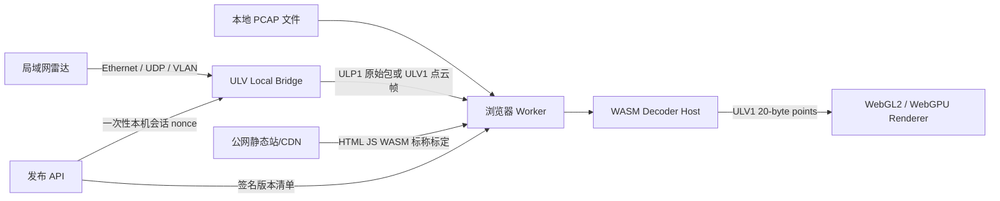

# Universal LiDAR Viewer 公网 WASM 版设计

## 1. 目标

公网服务器只负责分发静态网页、WASM 模块和签名版本清单。雷达数据不上传公网，抓包、解码、标定、组帧和 GPU 渲染均在用户现场设备完成。首版不包含一机一码或强制登录。

系统提供两个入口：

1. **PCAP 在线查看**：普通浏览器直接打开公网网站即可使用，不需要本地程序；PCAP 只在浏览器内存中处理。
2. **在线雷达查看**：网页负责显示和尽可能多的 WASM 解码，本地桥接器只负责浏览器无法执行的网卡抓包、VLAN、ARP 和临时网卡配置。

不把“绝对不可逆向”作为承诺。服务器不发布工程源码、调试符号或 source map；浏览器仍必须下载 WASM 二进制。

## 2. 总体架构



### 公网服务器不经过的数据

- MSOP、DIFOP、IMU 和状态包；
- 原始 PCAP；
- 解码后的 XYZ 点云；
- 用户网卡、ARP 和 VLAN 操作。

这样服务器容量基本只按网页文件下载量估算，而不是按雷达点频或在线人数估算。

## 3. 运行模式

### 3.1 PCAP 纯 WASM 模式

```text
File API -> PCAP Reader Worker -> Packet Router -> Vendor WASM -> ULV1 -> GPU
```

- 浏览器使用 `File.stream()` 分块读取文件，不把整个大文件一次性放进内存；
- 解析 classic PCAP，第二阶段再增加 PCAPNG；
- 保留 Ethernet、802.1Q 和 QinQ 信息；
- 按抓包时间回放，也支持最快速度离线解析；
- 页面关闭后文件句柄和内存立即释放；
- 不调用上传 API。

### 3.2 在线雷达模式

```text
Npcap -> Local Bridge -> 本机二进制流 -> Browser Worker -> WASM -> GPU
```

本地桥接器保留以下能力：

- Npcap 混杂模式抓包；
- 自动识别源/目标 IP、端口、VLAN/QinQ；
- RoboSense M1/M2 等设备的 VLAN ARP 应答；
- 临时添加 IPv4/VLAN 并在退出或异常恢复时还原；
- 管理员权限只在桥接器启动时申请；
- 只绑定本机回环控制端口，不接受公网连接。

本地桥接器不负责网页 UI。能在 WASM 中运行的型号发送原始包；暂时只能使用 Windows 厂商 SDK 的型号可在本地 DLL 解码后发送现有 `ULV1` 点云帧。两条路径在浏览器端使用相同渲染器。

### 3.3 解码能力分级

| 等级 | 数据路径 | 使用条件 |
|---|---|---|
| A：纯 WASM | 原始包 -> WASM -> 点云 | PCAP；可移植的厂商解析代码 |
| B：混合本地 | Npcap -> WASM -> 点云 | 在线雷达且解析器可编译为 WASM |
| C：原生回退 | Npcap -> DLL -> ULV1 | 厂商 SDK 暂不支持 Emscripten |

前端设备列表必须显示实际路径，例如 `WASM · Hesai AT128` 或 `Native fallback · Robin-W`，避免把回退误报成 WASM。

## 4. 组件设计

### 4.1 `ulv-web`

- 版本和本地桥接器状态提示；
- 顶部四项导航：点云显示、网络设置、PTP 设置、支持型号说明；
- PCAP 文件选择；
- 点云相机、颜色、距离和点大小；
- Worker 与 GPU 生命周期管理；
- 本地桥接器连接状态和明确的降级提示。

网页主线程只做 UI。PCAP、包分类、WASM 调用和帧整理全部放在 Worker。

### 4.2 `ulv-wasm-host`

以现有 `native/include/ulv_decoder_plugin.h` 为语义基准，不直接照搬含有裸指针和回调的动态库 ABI。WASM 导出最小接口：

```c
uint32_t ulv_wasm_abi_version(void);
int32_t ulv_wasm_create(const char* config_json, uint32_t config_size);
int32_t ulv_wasm_feed_packet(
    int32_t handle,
    const uint8_t* metadata,
    uint32_t metadata_size,
    const uint8_t* payload,
    uint32_t payload_size);
int32_t ulv_wasm_poll_frame(int32_t handle, uint8_t* output, uint32_t capacity);
void ulv_wasm_destroy(int32_t handle);
```

规则：

- JavaScript 与 WASM 之间批量传包，禁止逐点对象转换；
- 输出继续使用当前 `ULV1`：28 字节帧头后跟 20 字节点；
- 点结构保持 `x/y/z/intensity float32 + ring uint16 + return/flags uint8`；
- 每个雷达实例独立保存 DIFOP、标定、回波模式和组帧状态；
- WASM 模块不自行联网，不读取任意本机文件。

### 4.3 `ulv-local-bridge`

从当前 Python 服务中剥离为独立进程。首版可继续使用 Python 打包，正式保护版建议使用 Rust 或 C++ 重写高权限部分。

桥接器提供：

- `GET /v1/health`：版本、能力和运行状态；
- `POST /v1/session`：使用一次性 nonce 建立本机会话；
- `WS /v1/packets`：批量原始雷达包；
- `WS /v1/frames`：原生回退产生的 ULV1 帧；
- `GET/PUT /v1/network`：监听、网卡、VLAN 和过滤配置；
- `POST /v1/shutdown`：正常退出并恢复网卡。

控制服务只监听 `127.0.0.1`，启动时生成 256 位随机会话密钥。所有修改网卡的请求同时校验会话密钥、Origin 白名单、时间戳和一次性 nonce。

### 4.4 `ulv-release-api`

- 返回签名的版本清单；
- 为公网网页与本地桥接器握手生成一次性 nonce；
- 不接收点云或 PCAP；
- 发布签名私钥只存在于服务器密钥存储中；
- 首版不采集机器码，不限制设备数量。

## 5. 原始包协议 ULP1

本地桥接器按批发送二进制消息，避免每个 UDP 包产生一次 WebSocket 调用。

```text
Batch header
  magic          4 bytes   "ULP1"
  version        uint16    1
  flags          uint16
  packet_count   uint32
  batch_bytes    uint32

Packet record
  record_bytes   uint32
  timestamp_ns   uint64
  interface_id   uint16
  vlan_count     uint8     0..2
  ip_version     uint8     4/6
  source_port    uint16
  dest_port      uint16
  source_ip      16 bytes
  dest_ip        16 bytes
  source_mac     6 bytes
  dest_mac       6 bytes
  vlan_tci_0     uint16
  vlan_tci_1     uint16
  payload_bytes  uint32
  payload        N bytes
```

建议每批满足任一条件即发送：128 个包、256 KiB 或等待 2 ms。消息最大 1 MiB，超限直接拒绝。

## 6. 浏览器线程与内存模型

```text
UI Main Thread
  ├─ Renderer Worker / OffscreenCanvas（支持时）
  └─ Decoder Worker
       ├─ Packet ring buffer
       ├─ Detector
       ├─ Vendor WASM instances
       └─ Latest-frame slots
```

- 启用 WASM SIMD；
- 支持时启用 WASM Threads 和 `SharedArrayBuffer`；
- 不支持共享内存时退回 transferable `ArrayBuffer`；
- 每台雷达只保留最新完整帧以及一帧正在构建的数据；
- UI 来不及绘制时丢弃旧显示帧，不阻塞解码；
- WebGL2 为兼容基线，WebGPU 为可选加速，不作为首版硬要求。

目标预算：

| 指标 | 目标 |
|---|---:|
| AT128 输入 | 持续 10 FPS |
| 浏览器显示 | 10 FPS 或输入真实帧率 |
| Worker 主线程阻塞 | 单次低于 4 ms |
| 点云数据额外复制 | 每帧不超过 1 次 |
| 长时间队列 | 不允许持续增长 |
| 服务端点云带宽 | 0 |

## 7. 标定与 DIFOP

- 标称修正文件作为版本化二进制资源随 WASM 发布；
- 用户设备专属标定缓存在本地 IndexedDB，不上传公网；
- 在线 DIFOP 与 MSOP 按设备 MAC/源地址聚合；
- 设备专属标定优先级高于 SDK 标称修正；
- 缓存键包含厂商、型号、设备 MAC、标定哈希和格式版本；
- PCAP 缺失 DIFOP 时，允许用户选择本地标定文件或使用明确标识的标称修正；
- 页面始终显示当前标定来源，禁止静默使用错误型号标定。

## 8. 公网部署

静态站建议使用 Nginx、对象存储或 CDN，发布 API 单独部署。WASM 多线程需要以下响应头：

```nginx
location / {
    try_files $uri $uri/ /index.html;
    add_header Cross-Origin-Opener-Policy "same-origin" always;
    add_header Cross-Origin-Embedder-Policy "require-corp" always;
    add_header Cross-Origin-Resource-Policy "same-origin" always;
    add_header X-Content-Type-Options "nosniff" always;
}

location ~* \.wasm$ {
    default_type application/wasm;
    add_header Cache-Control "public, max-age=31536000, immutable";
    add_header Cross-Origin-Opener-Policy "same-origin" always;
    add_header Cross-Origin-Embedder-Policy "require-corp" always;
    add_header Cross-Origin-Resource-Policy "same-origin" always;
}
```

文件名使用内容哈希，例如 `hesai.a83d21.wasm`。`index.html` 不长期缓存，WASM 和静态资源长期缓存。更新清单必须签名，客户端先验签再切换版本。

## 9. 源码与发布保护

发布服务器只包含：

```text
index.html
assets/*.js
assets/*.css
wasm/*.wasm
calibration/*.bin
manifest.signed.json
downloads/ULV-LocalBridge.exe
```

不得发布：

- Git 仓库、测试、构建脚本和第三方 SDK 源码；
- `.pdb`、source map、私钥、发码工具；
- 内部错误堆栈和绝对构建路径。

Release WASM 删除名称段、DWARF、producer 信息和其他调试符号，并使用 `wasm-opt -Oz` 优化。JavaScript 压缩且不生成 source map。浏览器仍可保存 WASM，因此最有商业价值的多厂商协议识别、DIFOP 状态机、标定选择规则和异常包兼容逻辑默认保留在 C++/Rust 原生桥接器中；公网 WASM 主要承载 PCAP 容器读取、统一点格式、帧整理和渲染辅助。确需纯网页 PCAP 解码的厂商模块再按风险逐个开放。

发布前必须运行 `python packaging/audit_public_release.py <发布目录>`。任何源码、PDB、source map、密钥、构建脚本或开发目录都会使构建失败。

首版不使用一机一码。以后若需要限制商业使用，应作为独立产品功能增加，不能把授权逻辑当作代码防逆向手段。

## 10. 建议代码目录

```text
universal-lidar-viewer/
  apps/
    web/                    # 公网 SPA
    local-bridge/           # Windows 抓包桥接器
  crates-or-native/
    wasm-host/              # WASM ABI 与模块注册
    packet-format/          # ULP1/ULV1 共用定义
  decoders/
    velodyne/
    hesai/
    robosense/
    seyond/
  calibration/
  deployment/
    nginx/
    release-manifest/
  tests/
    pcap-regression/
    browser-performance/
```

不要立即移动现有源码。先新增 WASM 构建并保持现有 EXE 可用，待回归通过后再整理目录，以免同时破坏在线雷达和 Windows 发布版。

## 11. 实施顺序

### 第一阶段：PCAP WASM MVP

1. 移植 PCAP/Ethernet/VLAN 读取；
2. 移植 Velodyne 解码器作为第一条完整链路；
3. Worker 输出现有 ULV1，复用当前 WebGL2；
4. 验证文件不产生任何上传请求；
5. 使用现有 `D:/lidardata` 回归包比较点数、帧数和空间范围。

### 第二阶段：多厂商 WASM

1. Hesai；
2. RoboSense；
3. Seyond 可移植性评估；
4. 每个型号建立黄金 PCAP、帧率、点数和边界盒基线；
5. 无法移植的型号接入原生回退路径。

### 第三阶段：本地桥接器

1. 从现有 `capture.py` 提取只读抓包层；桌面端不包含自动修改网卡的逻辑；
2. 实现 ULP1 批量传输；
3. 保留 VLAN ARP 和异常恢复日志；
4. 增加公网门户的一次性启动 nonce；
5. 网页关闭后释放抓包句柄和临时网卡配置。

### 第四阶段：公网发布与加固

1. 静态站/CDN；
2. 签名版本清单；
3. Windows 代码签名；
4. 发布目录自动审计；
5. 灰度发布和自动回滚。

## 12. 验收条件

- PCAP 模式断网后仍可继续解析已经加载的文件；
- 浏览器开发者工具中没有 PCAP、UDP 或点云上传请求；
- 在线模式拔掉公网仍能继续显示点云；
- AT128 实际输入达到 10 FPS 且队列不增长；
- MSOP/DIFOP、VLAN 和设备身份正确聚合；
- 标定来源可见且与当前型号匹配；
- 关闭页面和桥接器后端口释放，网卡配置恢复；
- 公网发布目录不含源码、PDB、source map 或私钥；
- 公网发布流程不采集或校验机器码；
- 同一套页面可同时处理纯 WASM和原生回退设备。

## 13. 关键决策

首个可交付版本不尝试让普通网页直接抓取雷达网卡。PCAP 使用纯 WASM；在线雷达使用本地桥接。这样既保证公网服务器零点云压力，也保留当前产品已经实现的自动识别、VLAN、ARP 和跨网段能力。
